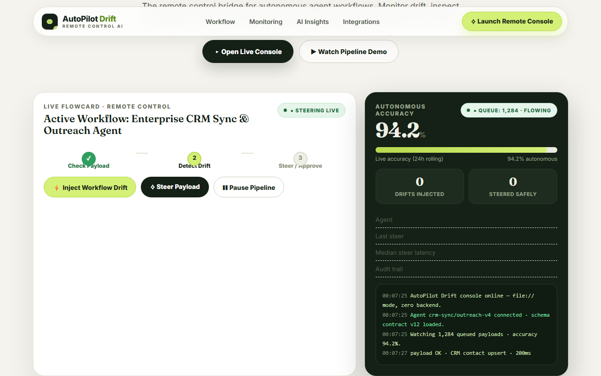
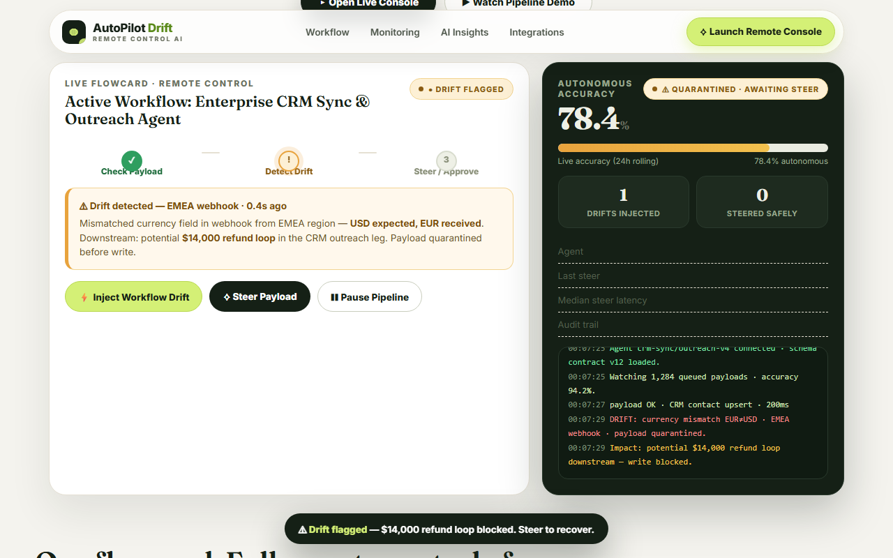
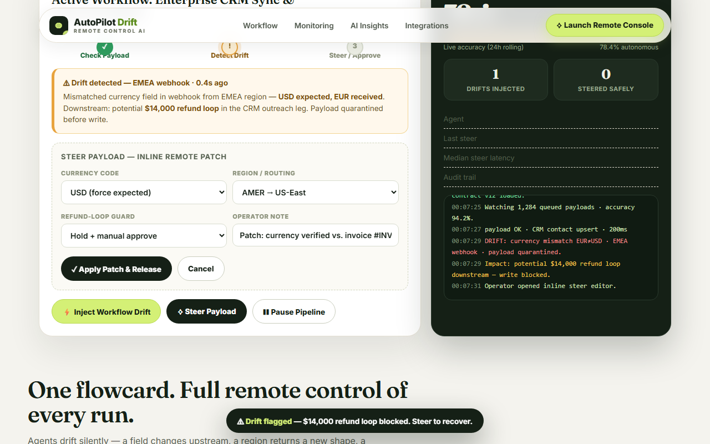
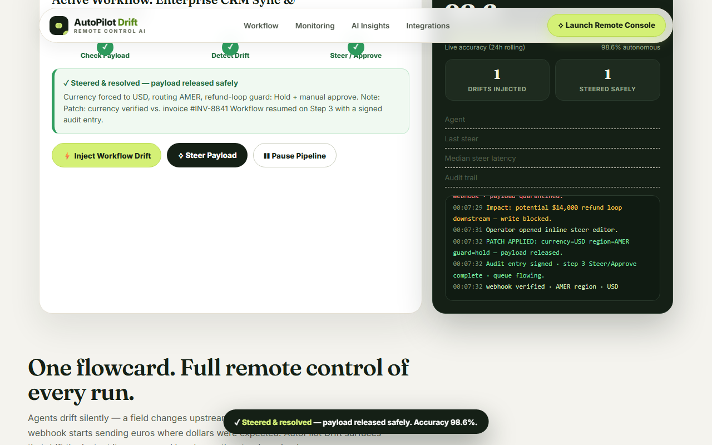

# AutoPilot Drift — Remote Control AI Steering Console

### Automation that keeps modern teams in control.

**Elevator pitch (Devpost, 158 chars):** AutoPilot Drift is the remote-control bridge for autonomous agents — detect silent workflow drift, steer runaway pipelines, and pause errors before they ship.

> Built for the **Remote Control AI Hackathon** · Remote Control AI 2026

**Repository:** [github.com/hariprasath71811-max/autopilot-drift](https://github.com/hariprasath71811-max/autopilot-drift)

**Live demo:** double-click [`index.html`](index.html) — no server, no install. Or open `file:///.../index.html` in Chrome/Edge.

**Demo video:** [`demo_with_audio.mp4`](demo_with_audio.mp4) (~95 s, voice + live UI) · silent capture [`demo.mp4`](demo.mp4) · script [`DEMO_SCRIPT.md`](DEMO_SCRIPT.md)



| Drift flagged (EMEA currency mismatch) | Steer editor (inline remote patch) | Steered & safe (98.6%) |
| --- | --- | --- |
|  |  |  |

---

## Why it exists

Autonomous agents run CRM sync, outreach, and billing — and their worst failure mode is not a crash. It is **silent workflow drift**: an upstream field changes, a region returns a new shape, a webhook starts sending euros where dollars were expected. The error ships, refunds loop, and nobody notices until customers do.

AutoPilot Drift puts a human remote control in front of every run: each payload is checked against a live schema contract, drift is flagged and quarantined the instant it appears, and the operator can **steer the payload remotely, pause the queue, or approve it** — with a signed audit entry. Automation keeps moving; humans stay in control.

### What judges can try in one click

| Action | Expected result | What it demonstrates |
| --- | --- | --- |
| `⚡ Inject Workflow Drift` | **⚠ DRIFT FLAGGED** · accuracy 94.2% → 78.4% · $14,000 refund-loop forecast | Live anomaly detection + blast-radius forecast |
| `Steer Payload` → `Apply Patch & Release` | **✓ Steered & resolved** · accuracy 98.6% · audit signed | Remote parameter patch + safe recovery |
| `Pause Pipeline` → `Resume Pipeline` | **❚❚ PAUSED BY OPERATOR** · queue held | Instant queue halt / resume |

Keyboard shortcut: press **`D`** anywhere to inject drift.

---

## Product experience

Single self-contained `index.html` with:

- Salifact-inspired editorial layout: soft beige `#F4F3EE`, electric lime `#D4F076`, deep forest `#152016`, Fraunces serif + Inter sans.
- Navbar with pill links (Workflow, Monitoring, AI Insights, Integrations) and a lime "Launch Remote Console" button.
- Interactive flowcard: `Check Payload → Detect Drift → Steer / Approve` step tracker, live accuracy bar (94.2%), and streaming event log.
- Inline steer editor (currency / region / refund-guard / operator note) that patches the payload remotely and releases it safely.
- WebAudio alert beeps, toast notifications, pause/resume queue control, scroll sections, and a closing call-to-action.
- No framework, no bundler, no backend, no build step. Double-click to run.

---

## Architecture

```text
┌──────────────────────────────────────────────────────────────────────────────┐
│                              Browser (file://)                               │
│  index.html — inline CSS + vanilla JS (complete app)                         │
│    • Flowcard: step tracker + accuracy bar + streaming log                  │
│    • Drift detector: schema-contract check + anomaly flag + quarantine      │
│    • Steer editor: currency / region / refund-guard patch + signed release  │
│    • Queue control: pause / resume + WebAudio beeps + toast notifications   │
└──────────────────────────────────────────────────────────────────────────────┘
                              │ operator click (no network call)
┌──────────────────────────────────────────────────────────────────────────────┐
│  scripts/ (optional, for demo reproduction only)                             │
│    make-voiceover.py  → narration.mp3  (edge-tts, System.Speech fallback)   │
│    record-demo.py     → Playwright video → demo.mp4 → demo_with_audio.mp4   │
│    screenshots.py     → docs/screenshots/*.png (README images)              │
└──────────────────────────────────────────────────────────────────────────────┘
```

**Deliberately dependency-free.** The detector, steer logic, log, and controls all live in `index.html`. `scripts/` are only needed to reproduce the demo video.

---

## Tech stack

| Layer | Technologies |
| --- | --- |
| **Frontend app** | HTML5, inline CSS (custom properties, no build), vanilla JavaScript |
| **Fonts** | Fraunces (editorial serif), Inter (sans UI) — Google Fonts with system fallbacks |
| **Drift engine** | INLINE schema-contract checker + anomaly scorer (contract v12) + blast-radius forecast |
| **Media (repro only)** | Playwright + Chromium (video), edge-tts / System.Speech (voice), imageio-ffmpeg (mux) |
| **Hosting** | Any static file host, or `file://` double-click — zero backend |

---

## Quick start

### Requirements

- A modern browser (Chrome/Edge/Firefox). No Node.js, no npm install, no server.
- Python 3.10+ + `pip install playwright imageio imageio-ffmpeg edge-tts` *[only to reproduce the video]*.

### Run the app (zero-backend)

```bat
:: Windows — double-click index.html, or serve locally:
cd autopilot-drift
run.bat
```

```bash
# macOS / Linux
cd autopilot-drift
chmod +x run.sh
./run.sh
# open http://localhost:8080/
```

Manual serve (any OS):

```bash
cd autopilot-drift
python -m http.server 8080
# open http://localhost:8080/
```

### Reproduce the demo video (~95-second `demo_with_audio.mp4`)

```bash
cd autopilot-drift

# 1. Generate the narration track from DEMO_SCRIPT.md's full script
python scripts/make-voiceover.py
# → narration.mp3 (edge-tts en-US-ChristopherNeural; offline fallback included)

# 2. Record the live UI with headless Playwright
python scripts/record-demo.py
# → demo.mp4 (1280×720 silent) + demo_with_audio.mp4 (muxed with narration)

# 3. (Optional) Capture README screenshots
python scripts/screenshots.py
# → docs/screenshots/*.png
```

The Playwright script opens `index.html` via `file://`, clicks `Inject Workflow Drift`, clicks `Steer Payload` → `Apply Patch & Release`, pauses/resumes the pipeline, scrolls the sections, and captures the full interaction — no backend required.

### API (none — intentionally)

There is no server API. The drift detector and steer logic are inline functions in `index.html` so the demo runs offline. For production, the same contract checker maps 1:1 to a `POST /check { payload, contract } → { drift, field, forecast }` and `POST /steer { patch, operator } → { released, audit_id }` endpoint.

---

## Project structure

```text
autopilot-drift/
├── index.html              # Complete app (double-click → runs)
├── README.md               # This file
├── DEMO_SCRIPT.md          # 90-second voiceover script + timing
├── demo.mp4                # Silent screen capture (1280×720)
├── demo_with_audio.mp4     # Final demo video (voice + UI)
├── narration.mp3           # Generated voiceover track
├── LICENSE
├── .gitignore
├── run.bat / run.sh        # Local static serve
├── docs/screenshots/       # README images
└── scripts/
    ├── make-voiceover.py   # TTS generation
    ├── make-voiceover.ps1  # Offline System.Speech fallback
    ├── record-demo.py      # Playwright capture + ffmpeg mux
    └── screenshots.py      # README screenshots
```

## License

MIT — see [`LICENSE`](LICENSE). Built as a hackathon demo; production deployment should add authenticated operator sessions and signed audit storage.

## Team / credits

Built for the **Remote Control AI** theme: one console to monitor drift, inspect anomalies, and steer autonomous agent workflows before errors ship. Video voiceover and Playwright capture are fully automated and reproducible with the scripts above.
